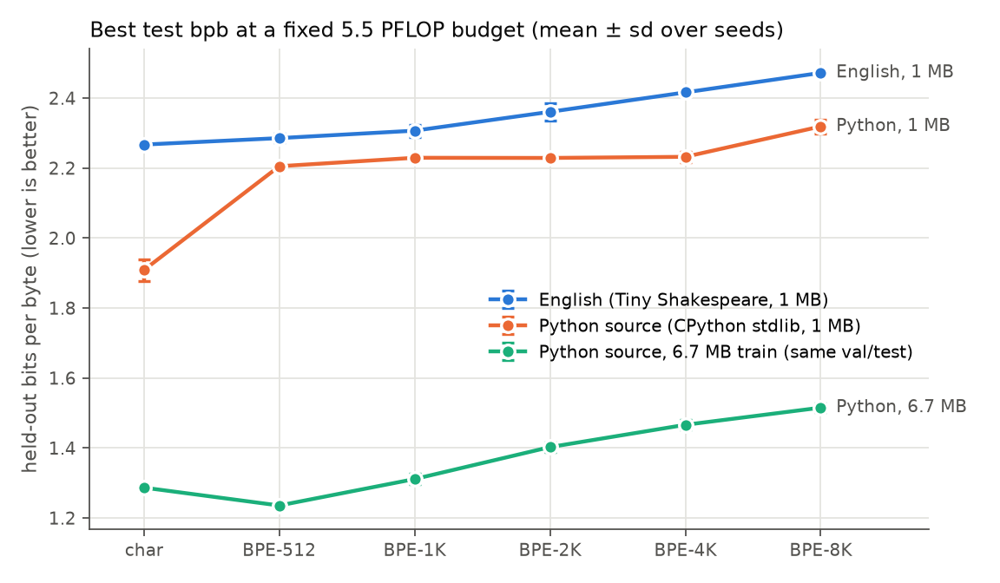

# Neural Networks: Zero to Hero, from scratch, plus a tokenizer study

A from-scratch implementation of Andrej Karpathy's
[*Neural Networks: Zero to Hero*](https://github.com/karpathy/nn-zero-to-hero) course:
an autograd engine, the makemore language models, a GPT and a GPT-4-compatible BPE tokenizer.
Every model is reproduced against the course's numbers and verified by tests. On top of that
code sits an extension: a controlled study of how tokenization affects language modeling under
a fixed compute budget.

## Part 1: the course, re-implemented

| # | Lecture | Implemented in `zero_to_hero/` | Result (mine vs course notebook) |
|---|---|---|---|
| 1 | micrograd | `micrograd/`: scalar autograd engine, Neuron/Layer/MLP | gradients match PyTorch; 100% accuracy on two-moons |
| 2 | makemore: bigrams | `makemore/bigram.py`: counting model, one-layer neural net | NLL 2.4546 (course 2.454) |
| 3 | makemore: MLP | `makemore/mlp.py`: Bengio et al. 2003 MLP | train / dev 2.124 / 2.169 (2.124 / 2.166) |
| 4 | makemore: BatchNorm | `makemore/layers.py`, `batchnorm.py`: init fixes, BatchNorm, activation/gradient diagnostics | dev 2.169 → 2.130 → 2.107 → 2.110 (2.166 → 2.131 → 2.107 → 2.105) |
| 5 | makemore: backprop ninja | `makemore/backprop.py`: hand-derived gradients for all 26 tensors (intermediates and parameters), fused cross-entropy and BatchNorm backward | max error vs autograd 4e-17; trained without autograd: dev 2.109 (2.111) |
| 6 | makemore: WaveNet | `makemore/wavenet.py`: hierarchical FlattenConsecutive model | dev 2.107 → 2.034 → 2.020 → 1.994, identical to the course to 3–4 decimals |
| 7 | Let's build GPT | `gpt/`: per-head and batched self-attention, Transformer blocks, char-level training | val 1.4815 (1.4856); bigram baseline 2.490 (≈2.49) |
| 8 | GPT tokenizer | `tokenizer/`: Basic and Regex BPE, special tokens, GPT-4 tokenizer | token-for-token match with tiktoken cl100k; BPE training 390× faster than the lecture algorithm |

Full table with train/dev numbers: [`results/lectures/summary.md`](results/lectures/summary.md).
BatchNorm diagnostics: [`results/lectures/batchnorm_diagnostics.png`](results/lectures/batchnorm_diagnostics.png).

**A finding from reproducing lecture 7.** Karpathy's final `gpt.py` adds an N(0, 0.02) weight
init that the video doesn't use. With the same 5,000 steps, that init fits the training set much
faster: train loss 0.86 vs 1.07, ending at val 1.555 vs 1.482. All three variants reach the same
best validation loss (1.47–1.48), just at different steps. The video's 1/√n_embd attention scaling
(instead of 1/√head_size) has little effect.

## Part 2: extension, a tokenizer ablation study

Does the tokenizer that compresses text best also train the best model under a fixed compute
budget? This trains the lecture-7 GPT (6 layers, 10.8–17M params) on **Tiny Shakespeare** and
**Python standard-library code**, comparing character-level tokenization against BPE with
512–8K vocab. That's 60 runs (3 seeds each) at a fixed 5.5 PFLOP budget, measuring held-out
**bits per byte**.



- **Better compression gave a worse model on 1 MB corpora.** Test bpb rose with every step up in
  vocab size: 2.27 (char) vs 2.47 (BPE-8K) on English. BPE models re-read the small corpus
  164–268 times under the same budget and overfit.
- **More data moves the optimum.** With 6.7× more Python code, BPE-512 beats char (1.24 vs 1.29
  bpb), while BPE-8K is still last.
- **The winner depends on the budget.** BPE-8K is best at small budgets on every corpus; finer
  tokenizers take over as compute grows.

Method, all tables and limitations: **[REPORT.md](REPORT.md)**.

## Layout

```
zero_to_hero/          the course
  micrograd/           engine.py, nn.py, train.py
  makemore/            data.py, bigram.py, mlp.py, layers.py, batchnorm.py, backprop.py, wavenet.py
  gpt/                 model.py, data.py, train.py
  tokenizer/           base.py, basic.py, regex.py, gpt4.py, char.py, train.py
  summarize.py         builds results/lectures/summary.md
tokbench/              the extension (built on zero_to_hero.gpt and zero_to_hero.tokenizer)
tests/                 19 tests: micrograd vs PyTorch, manual backprop vs autograd, attention
                       equivalence and causality, tokenizer round-trips and GPT-4 parity
data/                  names.txt, input.txt (Tiny Shakespeare), taylorswift.txt
results/lectures/      per-lecture results JSON, samples, figures
tokbench_out/          extension results (tables, figures, per-run JSON)
```

## Reproduce

Requirements: Python 3.12 and `pip install -r requirements.txt`; a CUDA GPU for lecture 7 and the extension.

```bash
python -m pytest tests                              # 19 tests, ~10 s

# Part 1: one command per lecture; each writes results/lectures/<name>.json
python -m zero_to_hero.micrograd.train
python -m zero_to_hero.makemore.bigram
python -m zero_to_hero.makemore.mlp
python -m zero_to_hero.makemore.batchnorm
python -m zero_to_hero.makemore.backprop
python -m zero_to_hero.makemore.wavenet
python -m zero_to_hero.gpt.train bigram
python -m zero_to_hero.gpt.train gpt_video          # the video's model (~9 min on an RTX 6000 Ada)
python -m zero_to_hero.gpt.train gpt                # with the final gpt.py init
python -m zero_to_hero.tokenizer.train
python -m zero_to_hero.summarize

# Part 2: tokenizer study (~2 GPU-hours)
python -m tokbench.data && python -m tokbench.tok_suite && python -m tokbench.tok_suite python_large
python -m tokbench.run_all --gpus 0,1 && python -m tokbench.run_all --corpora python_large
python -m tokbench.bench_bpe_trainer shakespeare && python -m tokbench.analyze
```

The Python corpus comes from the local interpreter's standard library. The results here used
CPython 3.12.7, and other versions give slightly different files.

## Credits

Course content and reference numbers: Andrej Karpathy's *Neural Networks: Zero to Hero* lectures
and the [chizkidd/Karpathy-Neural-Networks-Zero-to-Hero](https://github.com/chizkidd/Karpathy-Neural-Networks-Zero-to-Hero)
notebooks (MIT). `names.txt` comes from [karpathy/makemore](https://github.com/karpathy/makemore),
Tiny Shakespeare from [karpathy/char-rnn](https://github.com/karpathy/char-rnn), and `taylorswift.txt`
(a Wikipedia article) from [karpathy/minbpe](https://github.com/karpathy/minbpe).
