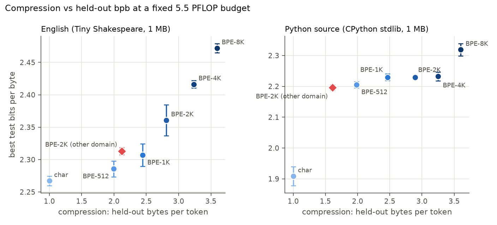
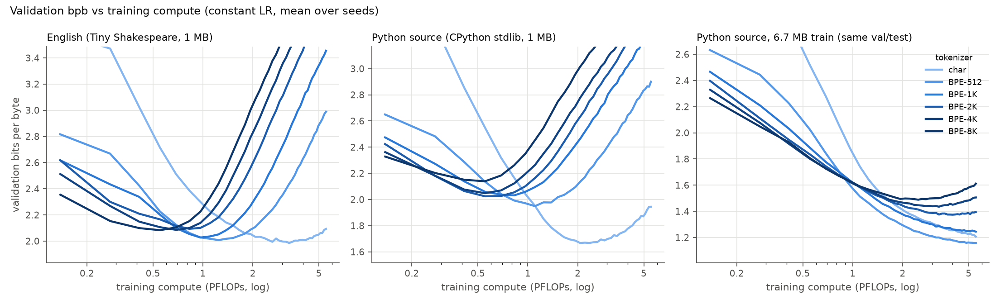

# Tokenizer evaluation & ablation suite

Extension of this project's from-scratch implementation of Karpathy's *Neural Networks: Zero to Hero*
(the lecture-7 GPT in `zero_to_hero/gpt/` and the lecture-8 BPE tokenizer in `zero_to_hero/tokenizer/`).
**Question:** does the tokenizer that compresses a corpus best also give the best language model
under a fixed compute budget?

**Short answer: no, not at this scale.** With 1 MB of training text, held-out bits-per-byte gets
monotonically *worse* as BPE compression improves (Spearman ρ = +1.00 on English, +0.94 on Python),
and character-level wins. Give the model 6.7× more data and the optimum moves to a small BPE
vocabulary (512), but the most aggressive vocab (8K) is still the worst. The ranking also flips with
the budget: coarse BPE wins at small budgets, finer tokenizers win once the budget is large enough
for coarse-BPE models to overfit.

---

## Setup

| | |
|---|---|
| Corpora | **English**: Tiny Shakespeare (the course corpus), 1.00 MB train. **Python**: ASCII source files from the CPython 3.12 stdlib, size-matched at 1.01 MB train. **Python-large**: 6.77 MB train, *same* val/test files (data-scale ablation). |
| Splits | 90 / 5 / 5 on document boundaries (doc = one speech / one source file). Val is used for early stopping, test for reporting. |
| Tokenizers | char, and this project's byte-level `RegexTokenizer` (GPT-4 regex pre-split) at 512 / 1K / 2K / 4K / 8K, each trained on that corpus' train split; **BPE-2K trained on the *other* corpus** (domain-mismatch ablation); tiktoken GPT-2 and cl100k (compression reference only) |
| Model | This project's lecture-7 GPT (`zero_to_hero/gpt/model.py`): 6 layers, 6 heads, d=384, 256-token context, dropout 0.2, AdamW 3e-4 constant LR, batch 64. Only the vocab size changes (10.8M → 17.0M params). Uses the batched-attention variant (one QKV projection + `scaled_dot_product_attention`), which is tested equal to the lecture's per-head version; bf16 autocast. |
| Compute budget | **5.52 PFLOPs per run** = the course's original char run (5000 steps × 64 × 256). FLOPs/token = 6N + 6·L·T·d, where N counts lm_head. Larger vocabs cost more per token, so they get fewer steps (8K: 3912 steps). |
| Metric | **Bits per byte** = Σ NLL / ln 2 / UTF-8 bytes, over the whole split with a sliding window (context 256, stride 128). Byte accounting is exact: every token is scored once, which an assert checks. bpb is comparable across tokenizers, unlike per-token loss. |
| Runs | 3 corpora × (6–7 tokenizers) × 3 seeds = **60 LM runs** on 2× RTX 6000 Ada (~2 GPU-hours) |

## Results


### Held-out quality at the fixed 5.5 PFLOP budget (best-val checkpoint, test bpb, mean ± sd over 3 seeds)

| tokenizer | English 1 MB | Python 1 MB | Python 6.7 MB |
|---|---|---|---|
| char | **2.267 ± 0.008** | **1.908 ± 0.031** | 1.287 ± 0.010 |
| BPE-512 | 2.286 ± 0.012 | 2.205 ± 0.010 | **1.236 ± 0.005** |
| BPE-1K | 2.307 ± 0.017 | 2.229 ± 0.011 | 1.311 ± 0.015 |
| BPE-2K | 2.361 ± 0.024 | 2.229 ± 0.007 | 1.403 ± 0.014 |
| BPE-4K | 2.416 ± 0.006 | 2.232 ± 0.014 | 1.466 ± 0.013 |
| BPE-8K | 2.472 ± 0.007 | 2.319 ± 0.020 | 1.515 ± 0.012 |
| BPE-2K, other domain | 2.313 ± 0.005 | 2.196 ± 0.009 | – |



### The answer depends on the budget



Constant LR means every point on a curve is a valid "smaller budget" run. Best tokenizer, with early
stopping, at each budget (val bpb):

| budget (PFLOPs) | English 1 MB | Python 1 MB | Python 6.7 MB |
|---|---|---|---|
| 0.25 | BPE-8K | BPE-8K | BPE-8K |
| 0.5 | BPE-8K | BPE-2K | BPE-4K |
| 1.0 | BPE-1K | BPE-512 | BPE-512 |
| 2.0 | BPE-512 | char | BPE-512 |
| 5.5 | char | char | BPE-512 |

### Intrinsic metrics (held-out = val + test)

| | English bytes/token | Python bytes/token | English median tokens/doc | Python median tokens/file | English vocab rare in train (<10 uses) |
|---|---|---|---|---|---|
| char | 1.00 | 1.00 | 59 | 2377 | 3% |
| BPE-512 | 1.99 | 1.98 | 32 | 1007 | 38% |
| BPE-2K | 2.81 | 2.89 | 23 | 665 | 18% |
| BPE-8K | 3.59 | 3.60 | 17 | 546 | 67% |
| BPE-2K, other domain | 2.12 | 1.61 | 30 | 1597 | 58% |
| tiktoken GPT-2 (50K) | 3.09 | 2.30 | 20 | 1179 | – |
| tiktoken cl100k (100K) | 3.54 | 4.18 | 18 | 511 | – |

### Systems costs (English, per run)

| | char | BPE-512 | BPE-2K | BPE-8K |
|---|---|---|---|---|
| train throughput (tokens/s) | 887K | 841K | 767K | 584K |
| train throughput (MB of text/s) | 0.89 | 1.72 | 2.42 | 2.31 |
| peak GPU memory | 1.52 GB | 1.54 GB | 1.90 GB | 3.39 GB |
| epochs over the data in budget | 82 | 164 | 241 | 252 |
| final val − train gap (bpb) | 0.88 | 2.82 | 3.81 | 4.07 |

Tokenizer speed, with pure Python on one core: BPE training takes ≤ 0.6 s for every vocab size
(fast trainer below); encoding runs at 3.3–3.9 MB/s versus 10–11 MB/s for tiktoken (Rust).

| BPE trainer (English train split) | vocab 512 | vocab 1024 |
|---|---|---|
| minbpe / course algorithm | 65.6 s | 175.1 s |
| naive, de-duplicated chunks | 5.9 s | 16.4 s |
| **ours** (dedup + incremental pair counts + lazy heap) | **0.38 s (174×)** | **0.44 s (394×)** |

The fast trainer produces merge-for-merge identical output to the naive reference (unit-tested).

## Findings

1. **Better compression ≠ better model when data is the bottleneck.** At 1 MB, every step up in
   vocab size makes test bpb worse. Under a FLOPs budget, a BPE model reads 2–3.6× more *bytes*
   per FLOP, but with only 1 MB available it just re-reads the same text more often: 164–268
   epochs versus 82 for char. All models peak at roughly 25–50 epochs, then memorize. Coarse
   tokenizers reach that point with less compute, so they peak earlier and lower. The final
   val−train gap grows from 0.9 bpb (char) to 4.1 bpb (BPE-8K).
2. **The crossover moves with data.** With 6.7× more Python, BPE-512 beats char by 0.05 bpb
   (1.236 vs 1.287, no overlap across seeds). The char model is now compute-limited: it's still
   improving at the end of the budget and has seen only 12 epochs. BPE-8K is still last. Its 17M-param model
   spends 22% of its FLOPs on the output softmax, and 61% of its vocab appears fewer than 10 times
   in the 1 MB tokenizer-training split, so those embedding and softmax rows get very little
   signal.
3. **The winner depends on the budget.** At 0.25 PFLOPs, BPE-8K wins on all three corpora: more
   text per FLOP is a pure gain before overfitting starts. As the budget grows, the optimum shifts
   toward finer tokenizers.
4. **Domain mismatch costs compression, not necessarily quality.** An English-trained BPE-2K
   compresses Python 44% worse than an in-domain BPE-2K (1.61 vs 2.89 bytes/token). Yet the model
   trained on it is slightly *better* (2.196 vs 2.229 bpb), which is consistent with finding 1. The
   compression loss does carry real costs: 2.4× more tokens per file and 53% lower bytes/s
   training throughput.
5. **Tokenizers overfit too.** BPE-8K compresses its own train split 10% (English) and 17%
   (Python) better than held-out text. Report compression on held-out data.

## Limitations

- One model size (10.8–17M params) and the course's untuned recipe: constant LR, dropout 0.2, no
  per-tokenizer tuning. Tuned regularization would likely narrow the BPE overfitting gap.
- The context is fixed at 256 *tokens*, so BPE models also see 2–4× more bytes of context. That
  is a real benefit of compression, but it's confounded with granularity here.
- Held-out sets are small (~55 KB each). For Python, val and test bpb differ by ~0.2 because
  different files are harder. The top two tokenizers match between val and test on every corpus;
  on English, BPE-2K/4K/8K reorder on val.
- Both corpora are ASCII. Multilingual and Unicode-heavy text, where byte-level vs char-level
  matters, isn't tested.

## Reproduce

```bash
python -m tokbench.data                       # corpora + splits (incl. python_large)
python -m tokbench.tok_suite                  # train tokenizers, intrinsic metrics, cache token ids
python -m tokbench.tok_suite python_large     # token ids for the data-scale ablation
python -m tokbench.run_all --gpus 0,1         # 42 LM runs (English + Python, 3 seeds)
python -m tokbench.run_all --corpora python_large
python -m tokbench.bench_bpe_trainer shakespeare
python -m tokbench.analyze                    # tables.md, lm_summary.json, figures/
python -m pytest tests
```

Code: `tokbench/` (data.py, tok_suite.py, train_lm.py, run_all.py, analyze.py, bench_bpe_trainer.py),
built on `zero_to_hero/gpt/` and `zero_to_hero/tokenizer/`; tests in `tests/`. Raw per-run JSON, with full learning curves and samples:
`tokbench_out/runs/`. All tables: `tokbench_out/results/tables.md`.
